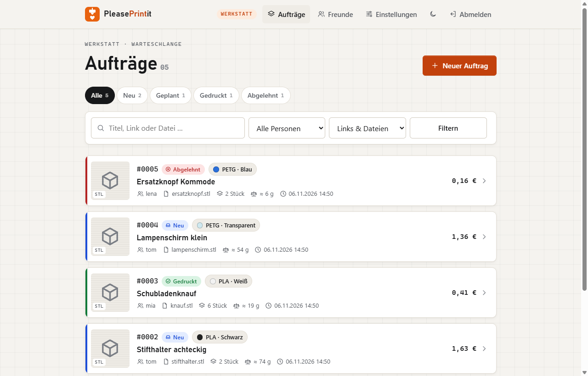
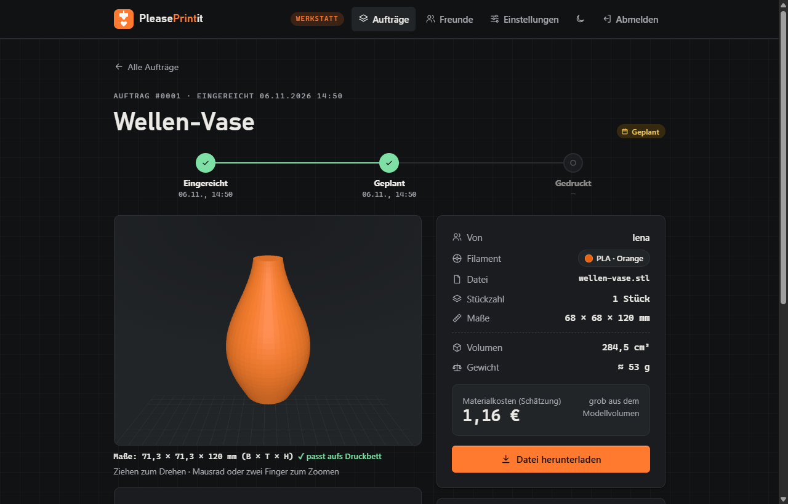
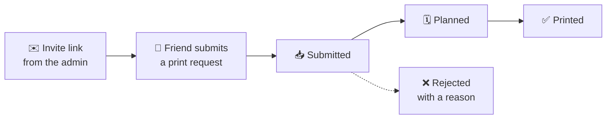

<p align="center">
  
</p>

<h1 align="center">PleasePrintit</h1>

<p align="center"><a href="README.md">Deutsch</a> · <b>English</b></p>

<p align="center">
  <b>The little print shop for your 3D printer.</b><br>
  Friends submit print requests, you work through them in order. No more links buried in chat history.
</p>

<p align="center">
  <a href="https://github.com/neodk2004/pleaseprintit/actions/workflows/ci.yml"></a>
  
  
  
  
  
  
  <a href="LICENSE"></a>
</p>
<p align="center">
  <a href="https://ko-fi.com/E8R028M0YO"></a>
</p>

<p align="center">
  <a href="#how-it-works">How it works</a> ·
  <a href="#features">Features</a> ·
  <a href="#which-tool-is-right-for-you">Comparison</a> ·
  <a href="#getting-started">Getting started</a> ·
  <a href="#prebuilt-image-only-no-git">Prebuilt image</a> ·
  <a href="#alternative-with-dockhand">Dockhand</a> ·
  <a href="#data-and-backups">Backups</a> ·
  <a href="#activity">Activity</a> ·
  <a href="#contributing">Contributing</a>
</p>

---

If you own a 3D printer, you know the drill: “Could you print this for me?”, plus a link, somewhere between holiday photos and voice messages. **PleasePrintit** collects those requests in one place. Friends sign up through a personal invite link, submit models with filament, color and quantity, and can check the progress of their request at any time. You get a tidy queue with previews and work through it at your own pace.

Built for a private circle of a handful up to about 50 people, self-hosted with Docker, no cloud, no tracking.

> **Note:** The app speaks **German, English and French** – everyone picks their language at the bottom of the page or in their profile. Menu names in this guide are given in German with the English meaning in brackets.

<p align="center">
  
  
</p>
<p align="center"><sub>Left: the print queue. Right: a request with 3D preview in dark mode. All names and models are demo data.</sub></p>

## How it works



| | For your friends | For you |
|---|---|---|
| **1** | Open the invite link, choose a name and password | Create an invite link under **Freunde** (friends) and send it |
| **2** | **Neuer Auftrag** (new request): paste a link or upload STL, 3MF or STEP, pick filament, color and quantity | Review the queue with preview, weight and cost |
| **3** | Follow the status, optionally by e-mail | Plan, print, mark as done |

## Features

- 🔗 **Requests by link or file:** a link to Printables, MakerWorld or Thingiverse (title and preview image are fetched automatically) or your own STL, 3MF or STEP file.
- 🧊 **3D preview in the browser:** rotate the model, see its dimensions, and check whether it fits your build plate. STEP files from CAD programs are read and measured right in the browser, too.
- 🖨️ **Open in slicer:** one click on a request opens the 3D file directly in OrcaSlicer, Bambu Studio or Creality Print on your computer. Pick which buttons appear in the settings.
- 🎨 **Filaments and colors:** you maintain what you have in stock. Friends pick from it or choose “Random”. Add a price per kg to get a material cost estimate.
- 💶 **“Printed for you”:** every friend sees on their profile how many parts you printed for them and roughly what the material cost. You see the total per person in the friends list. No payment feature, just so nobody has to guess.
- ☕ **Tip button:** add your PayPal.me or Ko-fi link and friends see a button on printed requests. The app itself handles no money.
- 📦 **Archive with search:** printed and rejected requests move to the archive after a configurable period or with a button (several at once). Find them again by title, file, friend or date range.
- 📈 **Statistics:** requests, grams and material cost per month, popular filaments and colors, waiting time and rejection reasons for you. Every friend sees their own numbers on their profile.
- 📊 **Clear status:** submitted → planned → printed, or rejected with a reason. Optional e-mail notifications.
- 🎟️ **Invite only:** invite links are valid for 7 days and can be used once. Accounts can be disabled, “forgot password” works via e-mail.
- ⚖️ **Fair limits:** at most 10 open requests and 500 MB of 3D files per person.
- 🌍 **German, English, French:** everyone picks their language at the bottom of the page or in their profile. It applies to the whole app and to status emails, which are always sent in the recipient’s language.
- 📱 **Mobile friendly:** installable on the home screen (PWA), with light and dark theme.
- 📄 **Legal notice and privacy page** (German *Impressum* / *Datenschutz*) built in, unreadable for address scrapers.
- 🍓 **Runs almost anywhere:** prebuilt image for x86 and ARM64, including a Raspberry Pi 4/5 with a 64-bit OS. About 50 MB of RAM when idle, SQLite instead of a database server, HTTPS optional.
- 💾 **Daily backups** with a verification tool, the last 14 are kept.
- 🔒 **Secure by default:** SSRF protection when fetching previews, CSP and HSTS headers, brute-force throttling on logins, container without extra privileges and with a read-only file system. The STEP reader runs isolated in a Web Worker.

## Which tool is right for you?

There are now three free, self-hosted tools for print requests. They come in different sizes, and each has its place:

| | **PleasePrintit** | [PrettyPleasePrint](https://github.com/danileau/prettypleaseprint) | [STL Quest](https://github.com/richardsolomou/stl.quest) |
|---|---|---|---|
| Built for | friends, one printer | small office, one printer | hobby up to print farm |
| Request by link | Printables, MakerWorld, Thingiverse | Printables only (opt-in) | five sites incl. MakerWorld |
| 3D preview | ✅ with build-plate check | ✅ | ✅ |
| Open in slicer | ✅ Orca, Bambu Studio, Creality Print, no extra software | ✅ PrusaSlicer, Orca, Bambu Studio, Elegoo, Cura, via a small helper app | – |
| Material cost | ✅ per request and per friend | – | – |
| Questions | rejection with a reason | ✅ comments on the request | notes |
| Several printers | – | – | ✅ with auto-assignment |
| Sign-in | invite + password | invite, passkeys, SSO | invite, SSO, 2FA |
| Raspberry Pi (ARM64) | ✅ | – (x86 only) | ✅ |
| Server needs | SQLite, ~50 MB RAM | Postgres, ~1 GB RAM, HTTPS required | SQLite or Postgres |
| UI language | German, English, French | English | English, French, German |
| License | MIT | AGPL-3.0 | AGPL-3.0 |

<sub>As of November 2026, based on each project's README. Something wrong? Please open an issue.</sub>

**What PleasePrintit deliberately leaves out:** single sign-on, an API, multiple printers, payments. That keeps it small: a handful of Python files you can read in an evening, started with one command.

- **Printing for friends and family** and want to know what it costs? → PleasePrintit.
- **One printer in an office**, you want to discuss requests and already have SSO? → PrettyPleasePrint.
- **Several printers or a small print farm?** → STL Quest.

## Getting started

You need Docker with Compose. The prebuilt image is available for x86 and ARM64, so it also runs on a Raspberry Pi 4/5 with a 64-bit OS.

```sh
git clone https://github.com/neodk2004/pleaseprintit.git
cd pleaseprintit
cp .env.example .env        # then change ADMIN_PASSWORD and SECRET_KEY
mkdir -p data backups
sudo chown 1000:1000 data backups   # Linux only: the app runs as user 1000 inside the container
docker compose up -d
```

Compose pulls the prebuilt image from `ghcr.io/neodk2004/pleaseprintit`. Prefer to build it yourself? Use `docker compose up -d --build`.

The app is then available at `http://<your-host>:8080` (different port: set `PORT` in `.env`). Log in with the name **admin** and your `ADMIN_PASSWORD`.

Generate random values for the secrets with:

```sh
python -c "import secrets; print(secrets.token_urlsafe(32))"
```

### Configuration (`.env`)

| Variable | Required | Description |
|---|---|---|
| `ADMIN_PASSWORD` | yes | password for the `admin` account |
| `SECRET_KEY` | yes | long random string used to sign sessions |
| `PORT` | no | port on the host, default `8080` |
| `PUBLIC_URL` | no | public HTTPS address behind a reverse proxy (for invite links and secure cookies) |
| `TZ` | no | time zone, default `Europe/Berlin` |
| `SMTP_HOST` | no | mail server; leave empty to disable e-mails |
| `SMTP_PORT` | no | default `587` (or `465` with `ssl`) |
| `SMTP_SECURITY` | no | `starttls` (default), `ssl` or `none` |
| `SMTP_USER`, `SMTP_PASSWORD` | no | login for the mail server (use an app password) |
| `SMTP_FROM` | no | sender, e.g. `PleasePrintit <print@example.org>` |

## Prebuilt image only (no Git)

The image is published as a [GitHub package](https://github.com/neodk2004/pleaseprintit/pkgs/container/pleaseprintit) at `ghcr.io/neodk2004/pleaseprintit`. It is public, no login needed. You don't need the source code, two files are enough:

```sh
mkdir pleaseprintit && cd pleaseprintit
curl -fsSLO https://raw.githubusercontent.com/neodk2004/pleaseprintit/main/compose.yaml
curl -fsSL -o .env https://raw.githubusercontent.com/neodk2004/pleaseprintit/main/.env.example
nano .env                   # change ADMIN_PASSWORD and SECRET_KEY
mkdir -p data backups
sudo chown 1000:1000 data backups   # Linux only
docker compose up -d
```

Compose picks the right image for your machine (x86 or ARM64). The app and the daily backup then run exactly as described above.

**Just want to try it?** A single command does it, but without the daily backup:

```sh
docker run -d --name pleaseprintit -p 8080:8000 \
  -e ADMIN_PASSWORD=your-password -e SECRET_KEY=long-random-string \
  -v pleaseprintit-data:/data ghcr.io/neodk2004/pleaseprintit:latest
```

**Which version?** The image comes with several tags:

| Tag | Meaning |
|---|---|
| `latest` | always the newest state, updated with every change |
| `1.0` | stays on version 1.0 but receives bug fixes (1.0.1, 1.0.2 …) |
| `1.0.0` | exactly this version, never changes |

If you'd rather decide yourself when to update, replace both `:latest` in `compose.yaml` with e.g. `:1.0`. All versions are listed under [Releases](https://github.com/neodk2004/pleaseprintit/releases).

**Update:** `docker compose pull && docker compose up -d`. Your data in `./data` is kept.

## Alternative: with Dockhand

If you use [Dockhand](https://dockhand.pro), no terminal is needed:

1. **GitHub access (private repo only):** on GitHub go to *Settings → Developer settings → Fine-grained tokens* and create a token for this repository only, with *Contents: Read-only*. In Dockhand, add it as the repository’s *Credential* (username = GitHub name, password = token).
2. **Create the stack:** *Stacks → From Git*, enter the repository URL, branch `main`, compose file `compose.dockhand.yaml`, and **enable “Build images on deploy”**.
3. **Stack variables:**

   | Variable | Required | Note |
   |---|---|---|
   | `ADMIN_PASSWORD` | yes | mark as *secret* |
   | `SECRET_KEY` | yes | long random string, mark as *secret* |
   | `PORT` | no | default `8080` |
   | `PUBLIC_URL` | no | only behind an HTTPS proxy |
   | `TZ` | no | default `Europe/Berlin` |
   | `SMTP_HOST`, `SMTP_PORT`, `SMTP_SECURITY`, `SMTP_USER`, `SMTP_PASSWORD`, `SMTP_FROM` | no | for status e-mails, mark the password as *secret* |

4. **Deploy.** The app is then available at `http://<your-host>:8080` or on the `PORT` you chose.

With this variant, data and backups live in Docker volumes (`<stack>_data`, `<stack>_backups`) instead of folders, so no `chown` is needed. Dockhand pulls updates via sync or webhook.

> [!CAUTION]
> **Do not delete the volumes when removing the stack, or your data is gone.**

## First steps as admin

1. Under **Einstellungen** (settings), enter your build plate size, your filaments and colors, and the legal notice.
2. Under **Freunde** (friends), click **Einladungslink erzeugen** (create invite link) for each friend and send them the link. A link is valid for 7 days and can be used once.

## How it works for your friends

1. Open the personal invite link and choose a name and a password (at least 8 characters).
2. Click **Neuer Auftrag** (new request), paste a model link **or** upload an STL, 3MF or STEP file, choose filament and color (“Random” = you decide), set the quantity, done.
3. Follow the status: **Eingereicht** (submitted) → **Geplant** (planned) → **Gedruckt** (printed), or **Abgelehnt** (rejected) with a reason.
4. Optional: add an e-mail address under **Profil** (profile) to get status updates and to be able to reset a forgotten password.

## Making it reachable from the internet

Put the app behind a reverse proxy with HTTPS, e.g. Nginx Proxy Manager, Caddy or Traefik, and set the address as `PUBLIC_URL` in `.env`. Once the proxy is in place, you can restrict the port in `compose.yaml` to `127.0.0.1:${PORT:-8080}:8000`.

## Data and backups

- All data lives in `./data` (database, preview images, 3D files).
- The `backup` container writes a daily backup to `./backups`, the last 14 are kept.
- Back up now: `docker compose run --rm backup python backup.py --once`
- Verify a backup: `docker compose run --rm backup python backup.py --check /backups/<file>.tar.gz`
- Restore: stop the app, extract the archive into `./data`, start the app.

## Updating

```sh
git pull
docker compose pull
docker compose up -d
```

If you build it yourself, use `git pull && docker compose up -d --build` instead.

## Tests

<details>
<summary>Run the tests locally</summary>

```sh
pip install -r requirements.txt
python test_app.py && python test_models.py && python test_preview.py && python test_i18n.py
```

</details>

Every push runs the tests, validates the compose files and test-starts the Docker image on x86 and ARM64 via GitHub Actions. When everything is green, the prebuilt image on ghcr.io is updated. Dependabot checks for outdated dependencies once a week.

## Activity

<p align="center">
  <a href="https://github.com/neodk2004/pleaseprintit/commits/main"></a>
  <a href="https://github.com/neodk2004/pleaseprintit/graphs/commit-activity"></a>
  <a href="https://github.com/neodk2004/pleaseprintit/issues"></a>
  <a href="https://github.com/neodk2004/pleaseprintit/pulls"></a>
  
</p>
<p align="center">
  <a href="https://github.com/neodk2004/pleaseprintit/stargazers"></a>
  <a href="https://github.com/neodk2004/pleaseprintit/watchers"></a>
  <a href="https://github.com/neodk2004/pleaseprintit/forks"></a>
</p>

## Contributing

- 🐞 **Found a bug or have an idea?** Just open an [issue](https://github.com/neodk2004/pleaseprintit/issues), in English or German.
- 🔐 **Security issue?** Please don’t report it publicly, follow [SECURITY.md](SECURITY.md) instead.
- 📝 **What's new?** All changes per version are listed in [CHANGELOG.en.md](CHANGELOG.en.md).
- 🤖 **Working on the code with an AI agent?** Layout, commands and conventions are in [AGENTS.md](AGENTS.md).
- ⭐ **Like the project?** A star helps others find it. If you want, buy me a coffee on [Ko-fi](https://ko-fi.com/E8R028M0YO).

## License

[MIT](LICENSE): free to use, modify and share, as long as the license notice is kept.
