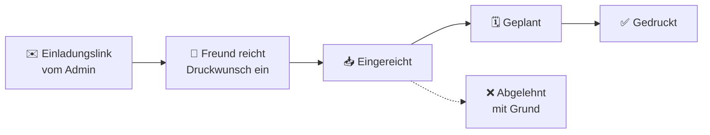

<p align="center">
  
</p>

<h1 align="center">PleasePrintit</h1>

<p align="center"><b>Deutsch</b> · <a href="README.en.md">English</a></p>

<p align="center">
  <b>Die kleine Druck-Werkstatt für deinen 3D-Drucker.</b><br>
  Freunde reichen Druckwünsche ein, du arbeitest sie sortiert ab. Schluss mit Links im Chat-Verlauf.
</p>

<p align="center">
  <a href="https://github.com/neodk2004/pleaseprintit/actions/workflows/ci.yml"></a>
  
  
  
  
  
  
  <a href="LICENSE"></a>
</p>
<p align="center">
  <a href="https://ko-fi.com/E8R028M0YO"></a>
</p>

<p align="center">
  <a href="#so-läufts-ab">So läuft's ab</a> ·
  <a href="#funktionen">Funktionen</a> ·
  <a href="#welches-tool-passt-zu-dir">Vergleich</a> ·
  <a href="#starten">Starten</a> ·
  <a href="#nur-mit-dem-fertigen-image-ohne-git">Fertiges Image</a> ·
  <a href="#alternative-mit-dockhand">Dockhand</a> ·
  <a href="#daten-und-sicherung">Sicherung</a> ·
  <a href="#aktivität">Aktivität</a> ·
  <a href="#mitmachen">Mitmachen</a>
</p>

---

Wer einen 3D-Drucker hat, kennt das: „Kannst du mir das mal drucken?“, dazu ein Link, irgendwo zwischen Urlaubsfotos und Sprachnachrichten. **PleasePrintit** sammelt diese Wünsche an einem Ort. Freunde melden sich über einen persönlichen Einladungslink an, reichen Modelle mit Filament, Farbe und Stückzahl ein und sehen jederzeit, wie weit ihr Auftrag ist. Du bekommst eine aufgeräumte Liste mit Vorschau und arbeitest sie in Ruhe ab.

Gedacht für den privaten Kreis von einer Handvoll bis etwa 50 Leuten, selbst gehostet mit Docker, ohne Cloud und ohne Tracking. Läuft auf dem NAS, einem kleinen Server oder einem **Raspberry Pi**: fertiges Image, ein Befehl, keine Datenbank einzurichten.

<p align="center">
  
  
</p>
<p align="center"><sub>Links: die Warteschlange der Werkstatt. Rechts: ein Auftrag mit 3D-Vorschau im dunklen Design. Alle Namen und Modelle sind Demodaten.</sub></p>

> **In English:** PleasePrintit is a self-hosted **3D print request queue** for people who own a 3D printer and keep getting “can you print this for me?” messages. Friends join via invite link and submit print requests from Printables, MakerWorld or Thingiverse links or their own STL/3MF files, pick filament and color, and track the status (submitted → planned → printed). You get a sorted queue with an in-browser 3D model viewer, build-plate fit check, filament weight and cost estimate, e-mail notifications and daily backups. Runs as a hardened Docker container (Flask, SQLite, three.js) with a prebuilt multi-arch image (amd64 and arm64, so a Raspberry Pi works too) and deploys with Docker Compose or Dockhand. The user interface is available in German, English and French. **→ [Full English guide](README.en.md)**

## So läuft's ab



| | Für deine Freunde | Für dich |
|---|---|---|
| **1** | Einladungslink öffnen, Name und Passwort wählen | Unter **Freunde** einen Einladungslink erzeugen und verschicken |
| **2** | **Neuer Auftrag:** Link einfügen oder STL, 3MF oder STEP hochladen, Filament, Farbe und Stückzahl wählen | Die Warteschlange mit Vorschau, Gewicht und Kosten ansehen |
| **3** | Status verfolgen, auf Wunsch per E-Mail | Auftrag planen, drucken, abhaken |

## Funktionen

- 🔗 **Aufträge per Link oder Datei:** Link zu Printables, MakerWorld oder Thingiverse (Titel und Vorschaubild werden automatisch geholt) oder eine eigene STL-, 3MF- oder STEP-Datei.
- 🧊 **3D-Vorschau im Browser:** Modell drehen, Maße ansehen, Prüfung, ob es aufs Druckbett passt. Auch STEP-Dateien aus CAD-Programmen werden direkt im Browser gelesen und vermessen.
- 🎨 **Filamente und Farben:** Du pflegst, was du da hast. Freunde wählen daraus oder sagen „Random“. Mit Preis pro kg gibt es eine Materialkosten-Schätzung.
- 💶 **„Für dich gedruckt“:** Jeder Freund sieht im Profil, wie viele Teile du für ihn gedruckt hast und was das Material ungefähr gekostet hat. Du siehst die Summe pro Person in der Freundesliste. Ganz ohne Bezahlfunktion, nur damit niemand raten muss.
- ☕ **Trinkgeld-Knopf:** Trag deinen PayPal.me- oder Ko-fi-Link ein, dann sehen Freunde einen Knopf bei gedruckten Aufträgen. Die App selbst verarbeitet kein Geld.
- 📦 **Archiv mit Suche:** Gedruckte und abgelehnte Aufträge wandern nach einer einstellbaren Frist oder per Knopf (auch mehrere auf einmal) ins Archiv. Dort findest du sie über die Suche nach Titel, Datei oder Freund und über einen Zeitraum wieder.
- 📈 **Statistik:** Für dich Aufträge, Gramm und Materialkosten pro Monat, beliebte Filamente und Farben, Wartezeit und Ablehnungsgründe. Jeder Freund sieht seine eigenen Zahlen im Profil.
- 📊 **Klarer Status:** Eingereicht → Geplant → Gedruckt, oder Abgelehnt mit Grund. Auf Wunsch per E-Mail.
- 🎟️ **Nur auf Einladung:** Einladungslinks gelten 7 Tage und nur einmal. Konten lassen sich sperren, „Passwort vergessen“ läuft per Mail.
- ⚖️ **Faire Grenzen:** höchstens 10 offene Aufträge und 500 MB 3D-Dateien pro Person.
- 🌍 **Deutsch, Englisch, Französisch:** Jeder wählt seine Sprache unten auf der Seite oder im Profil. Sie gilt für die ganze App und für die Status-Mails, die immer in der Sprache des Empfängers rausgehen.
- 📱 **Handy-tauglich:** als App auf dem Startbildschirm installierbar (PWA), mit hellem und dunklem Design.
- 📄 **Impressum und Datenschutz** direkt in der App, für Adress-Sammler unlesbar.
- 🍓 **Läuft fast überall:** fertiges Image für x86 und ARM64, also auch Raspberry Pi 4/5 mit 64-Bit-System. Rund 50 MB Arbeitsspeicher im Leerlauf, SQLite statt Datenbankserver, HTTPS optional.
- 💾 **Tägliche Sicherung** mit Prüffunktion, die letzten 14 bleiben liegen.
- 🔒 **Sicher eingestellt:** Schutz gegen SSRF beim Abruf von Vorschauen, CSP- und HSTS-Header, Bremse gegen Passwort-Raten, Container ohne Sonderrechte und mit schreibgeschütztem System. Der STEP-Leser läuft abgeschottet in einem Web Worker.

## Welches Tool passt zu dir?

Es gibt inzwischen drei freie, selbst gehostete Tools für Druckwünsche. Sie sind unterschiedlich groß, und jedes hat seinen Platz:

| | **PleasePrintit** | [PrettyPleasePrint](https://github.com/danileau/prettypleaseprint) | [STL Quest](https://github.com/richardsolomou/stl.quest) |
|---|---|---|---|
| Gedacht für | Freundeskreis, ein Drucker | kleines Büro, ein Drucker | Hobby bis Druckfarm |
| Wunsch per Link | Printables, MakerWorld, Thingiverse | nur Printables (abschaltbar) | fünf Seiten, u. a. MakerWorld |
| 3D-Vorschau | ✅ mit Druckbett-Check | ✅ | ✅ |
| Materialkosten | ✅ pro Auftrag und pro Freund | – | – |
| Rückfragen | Ablehnung mit Grund | ✅ Kommentare am Auftrag | Notizen |
| Mehrere Drucker | – | – | ✅ mit Auto-Zuteilung |
| Anmeldung | Einladung + Passwort | Einladung, Passkeys, SSO | Einladung, SSO, 2FA |
| Raspberry Pi (ARM64) | ✅ | – (nur x86) | ✅ |
| Server-Bedarf | SQLite, ~50 MB RAM | Postgres, ~1 GB RAM, HTTPS Pflicht | SQLite oder Postgres |
| Oberfläche | Deutsch, Englisch, Französisch | Englisch | Englisch, Französisch, Deutsch |
| Lizenz | MIT | AGPL-3.0 | AGPL-3.0 |

<sub>Stand November 2026, nach den Angaben in den READMEs der Projekte. Etwas falsch? Bitte ein Issue aufmachen.</sub>

**Was PleasePrintit bewusst nicht hat:** Single Sign-on, eine Programmierschnittstelle, mehrere Drucker, Bezahlfunktionen. Das hält die App klein: wenige Python-Dateien, die man an einem Abend durchgelesen hat, und ein Start mit einem Befehl.

- **Du druckst für Freunde und Familie** und willst wissen, was es kostet? → PleasePrintit.
- **Ein Drucker im Büro**, ihr wollt am Auftrag diskutieren und habt schon SSO? → PrettyPleasePrint.
- **Mehrere Drucker oder eine kleine Druckfarm?** → STL Quest.

## Starten

Du brauchst Docker mit Compose. Das fertige Image gibt es für x86 und ARM64, es läuft also auch auf einem Raspberry Pi 4/5 mit 64-Bit-System.

```sh
git clone https://github.com/neodk2004/pleaseprintit.git
cd pleaseprintit
cp .env.example .env        # dann ADMIN_PASSWORD und SECRET_KEY ändern
mkdir -p data backups
sudo chown 1000:1000 data backups   # nur Linux: die App läuft im Container als Benutzer 1000
docker compose up -d
```

Compose lädt das fertige Image von `ghcr.io/neodk2004/pleaseprintit`. Lieber selbst bauen? Dann `docker compose up -d --build`.

Danach läuft die App unter `http://<dein-rechner>:8080` (anderer Port: `PORT` in der `.env`). Melde dich mit dem Namen **admin** und deinem `ADMIN_PASSWORD` an.

## Nur mit dem fertigen Image (ohne Git)

Das Image liegt als [Package auf GitHub](https://github.com/neodk2004/pleaseprintit/pkgs/container/pleaseprintit) unter `ghcr.io/neodk2004/pleaseprintit`. Es ist öffentlich, ein Login ist nicht nötig. Den Quellcode brauchst du nicht, zwei Dateien reichen:

```sh
mkdir pleaseprintit && cd pleaseprintit
curl -fsSLO https://raw.githubusercontent.com/neodk2004/pleaseprintit/main/compose.yaml
curl -fsSL -o .env https://raw.githubusercontent.com/neodk2004/pleaseprintit/main/.env.example
nano .env                   # ADMIN_PASSWORD und SECRET_KEY ändern
mkdir -p data backups
sudo chown 1000:1000 data backups   # nur Linux
docker compose up -d
```

Compose holt das passende Image für deinen Rechner (x86 oder ARM64) selbst. Die App und die tägliche Sicherung laufen dann genau wie oben.

**Nur kurz ausprobieren?** Ein einzelner Befehl genügt, allerdings ohne tägliche Sicherung:

```sh
docker run -d --name pleaseprintit -p 8080:8000 \
  -e ADMIN_PASSWORD=dein-passwort -e SECRET_KEY=lange-zufallszeichenkette \
  -v pleaseprintit-data:/data ghcr.io/neodk2004/pleaseprintit:latest
```

**Welche Version?** Das Image gibt es mit mehreren Tags:

| Tag | Bedeutung |
|---|---|
| `latest` | immer der neueste Stand, bei jeder Änderung aktualisiert |
| `1.0` | bleibt bei Version 1.0, bekommt aber Fehlerbehebungen (1.0.1, 1.0.2 …) |
| `1.0.0` | genau diese Version, ändert sich nie |

Wer lieber selbst entscheidet, wann ein Update kommt, ersetzt in der `compose.yaml` beide Male `:latest` durch z. B. `:1.0`. Alle Versionen stehen unter [Releases](https://github.com/neodk2004/pleaseprintit/releases).

**Update:** `docker compose pull && docker compose up -d`. Die Daten in `./data` bleiben dabei erhalten.

## Alternative: mit Dockhand

Ist [Dockhand](https://dockhand.pro) im Einsatz, braucht es kein Terminal:

1. **Zugang für GitHub (nur bei privatem Repo):** Auf GitHub unter *Settings → Developer settings → Fine-grained tokens* einen Token anlegen. Nur dieses Repo freigeben, Recht *Contents: Read-only*. In Dockhand beim Repo unter *Zugangsdaten* hinterlegen (Benutzer = GitHub-Name, Passwort = Token).
2. **Stack anlegen:** *Stacks → Aus Git*, Repo-Adresse eintragen, Branch `main`, Compose-Datei `compose.dockhand.yaml`, **„Images beim Bereitstellen bauen“ einschalten**.
3. **Stack-Variablen:**

   | Variable | Pflicht | Hinweis |
   |---|---|---|
   | `ADMIN_PASSWORD` | ja | als *Secret* markieren |
   | `SECRET_KEY` | ja | lange Zufallszeichenkette, als *Secret* markieren |
   | `PORT` | nein | Standard `8080` |
   | `PUBLIC_URL` | nein | nur hinter einem HTTPS-Proxy |
   | `TZ` | nein | Standard `Europe/Berlin` |
   | `SMTP_HOST`, `SMTP_PORT`, `SMTP_SECURITY`, `SMTP_USER`, `SMTP_PASSWORD`, `SMTP_FROM` | nein | für Status-Mails, Passwort als *Secret* |

4. **Deploy.** Die App läuft dann unter `http://<dein-rechner>:8080` bzw. unter dem gewählten `PORT`.

Bei dieser Variante liegen die Daten und Sicherungen in Docker-Volumes (`<stack>_data`, `<stack>_backups`) statt in Ordnern, `chown` ist nicht nötig. Updates holt Dockhand per Sync oder Webhook.

> [!CAUTION]
> **Volumes beim Löschen des Stacks nicht mitlöschen, sonst sind die Daten weg.**

## Erste Schritte als Admin

1. Unter **Einstellungen** dein Druckbett, deine Filamente und das Impressum eintragen.
2. Unter **Freunde** für jeden Freund auf **Einladungslink erzeugen** klicken und ihm den Link schicken. Ein Link gilt 7 Tage und nur einmal.

## Von außen erreichbar machen

Stell die App hinter einen Reverse Proxy mit HTTPS, z. B. Nginx Proxy Manager, Caddy oder Traefik, und trag die Adresse als `PUBLIC_URL` in die `.env` ein. Ist der Proxy da, kann der Port in `compose.yaml` auf `127.0.0.1:${PORT:-8080}:8000` beschränkt werden.

## Daten und Sicherung

- Alle Daten liegen in `./data` (Datenbank, Vorschaubilder, 3D-Dateien).
- Der `backup`-Container legt täglich eine Sicherung in `./backups` ab, die letzten 14 bleiben.
- Sofort sichern: `docker compose run --rm backup python backup.py --once`
- Sicherung prüfen: `docker compose run --rm backup python backup.py --check /backups/<datei>.tar.gz`
- Wiederherstellen: App stoppen, Archiv nach `./data` auspacken, App starten.

## Update

```sh
git pull
docker compose pull
docker compose up -d
```

Wer selbst baut, nimmt stattdessen `git pull && docker compose up -d --build`.

## Tests

<details>
<summary>Tests lokal ausführen</summary>

```sh
pip install -r requirements.txt
python test_app.py && python test_models.py && python test_preview.py && python test_i18n.py
```

</details>

Bei jedem Push laufen die Tests, die Prüfung der Compose-Dateien und ein Probestart des Docker-Images auf x86 und ARM64 automatisch über GitHub Actions. Sind alle grün, wird das fertige Image auf ghcr.io aktualisiert. Dependabot meldet einmal pro Woche veraltete Abhängigkeiten.

## Aktivität

<p align="center">
  <a href="https://github.com/neodk2004/pleaseprintit/commits/main"></a>
  <a href="https://github.com/neodk2004/pleaseprintit/graphs/commit-activity"></a>
  <a href="https://github.com/neodk2004/pleaseprintit/issues"></a>
  <a href="https://github.com/neodk2004/pleaseprintit/pulls"></a>
  
</p>
<p align="center">
  <a href="https://github.com/neodk2004/pleaseprintit/stargazers"></a>
  <a href="https://github.com/neodk2004/pleaseprintit/watchers"></a>
  <a href="https://github.com/neodk2004/pleaseprintit/forks"></a>
</p>

## Mitmachen

- 🐞 **Fehler gefunden oder eine Idee?** Einfach ein [Issue](https://github.com/neodk2004/pleaseprintit/issues) aufmachen, gern auf Deutsch oder Englisch.
- 🔐 **Sicherheitslücke?** Bitte nicht öffentlich, sondern wie in [SECURITY.md](SECURITY.md) beschrieben melden.
- 📝 **Was ist neu?** Alle Änderungen pro Version stehen in [CHANGELOG.md](CHANGELOG.md).
- 🤖 **Mit KI-Agenten am Code arbeiten?** Aufbau, Befehle und Regeln stehen in [AGENTS.md](AGENTS.md).
- ⭐ **Gefällt dir das Projekt?** Ein Stern hilft anderen, es zu finden. Wer mag, gibt auf [Ko-fi](https://ko-fi.com/E8R028M0YO) einen Kaffee aus.

## Lizenz

[MIT](LICENSE): frei nutzbar, veränderbar und weitergebbar, solange der Lizenzhinweis erhalten bleibt.
