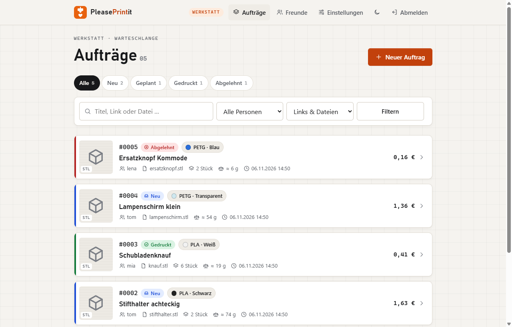
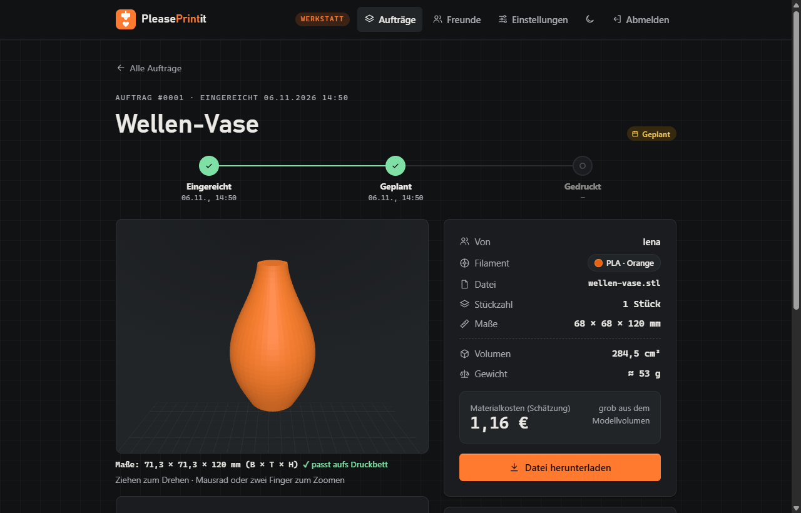

<p align="center">
  
</p>

<h1 align="center">PleasePrintit</h1>

<p align="center"><b>Deutsch</b> · <a href="README.en.md">English</a></p>

<p align="center">
  <b>Die kleine Druck-Werkstatt für deinen 3D-Drucker.</b><br>
  Freunde reichen Druckwünsche ein, du arbeitest sie sortiert ab. Schluss mit Links im Chat-Verlauf.
</p>

<p align="center">
  <a href="https://github.com/neodk2004/pleaseprintit/actions/workflows/ci.yml"></a>
  
  
  
  
  
  <a href="LICENSE"></a>
</p>

---

Wer einen 3D-Drucker hat, kennt das: „Kannst du mir das mal drucken?“, dazu ein Link, irgendwo zwischen Urlaubsfotos und Sprachnachrichten. **PleasePrintit** sammelt diese Wünsche an einem Ort. Freunde melden sich über einen persönlichen Einladungslink an, reichen Modelle mit Filament, Farbe und Stückzahl ein und sehen jederzeit, wie weit ihr Auftrag ist. Du bekommst eine aufgeräumte Liste mit Vorschau und arbeitest sie in Ruhe ab.

Gedacht für den privaten Kreis von einer Handvoll bis etwa 50 Leuten, selbst gehostet mit Docker, ohne Cloud und ohne Tracking.

<p align="center">
  
  
</p>
<p align="center"><sub>Links: die Warteschlange der Werkstatt. Rechts: ein Auftrag mit 3D-Vorschau im dunklen Design. Alle Namen und Modelle sind Demodaten.</sub></p>

> **In English:** PleasePrintit is a self-hosted **3D print request queue** for people who own a 3D printer and keep getting “can you print this for me?” messages. Friends join via invite link and submit print requests from Printables, MakerWorld or Thingiverse links or their own STL/3MF files, pick filament and color, and track the status (submitted → planned → printed). You get a sorted queue with an in-browser 3D model viewer, build-plate fit check, filament weight and cost estimate, e-mail notifications and daily backups. Runs as a hardened Docker container (Flask, SQLite, three.js) and deploys with Docker Compose or Dockhand. The user interface is in German. **→ [Full English guide](README.en.md)**

## Funktionen

- **Aufträge per Link oder Datei:** Link zu Printables, MakerWorld oder Thingiverse (Titel und Vorschaubild werden automatisch geholt) oder eine eigene STL-/3MF-Datei.
- **3D-Vorschau im Browser:** Modell drehen, Maße ansehen, Prüfung, ob es aufs Druckbett passt.
- **Filamente und Farben:** Du pflegst, was du da hast. Freunde wählen daraus oder sagen „Random“. Mit Preis pro kg gibt es eine Materialkosten-Schätzung.
- **Klarer Status:** Eingereicht → Geplant → Gedruckt, oder Abgelehnt mit Grund. Auf Wunsch per E-Mail.
- **Nur auf Einladung:** Einladungslinks gelten 7 Tage und nur einmal. Konten lassen sich sperren, „Passwort vergessen“ läuft per Mail.
- **Faire Grenzen:** höchstens 10 offene Aufträge und 500 MB 3D-Dateien pro Person.
- **Handy-tauglich:** als App auf dem Startbildschirm installierbar (PWA), mit hellem und dunklem Design.
- **Impressum und Datenschutz** direkt in der App, für Adress-Sammler unlesbar.
- **Tägliche Sicherung** mit Prüffunktion, die letzten 14 bleiben liegen.
- **Sicher eingestellt:** Schutz gegen SSRF beim Abruf von Vorschauen, CSP- und HSTS-Header, Bremse gegen Passwort-Raten, Container ohne Sonderrechte und mit schreibgeschütztem System.

## Starten

Du brauchst Docker mit Compose.

```sh
git clone https://github.com/neodk2004/pleaseprintit.git
cd pleaseprintit
cp .env.example .env        # dann ADMIN_PASSWORD und SECRET_KEY ändern
mkdir -p data backups
sudo chown 1000:1000 data backups   # nur Linux: die App läuft im Container als Benutzer 1000
docker compose up -d --build
```

Danach läuft die App unter `http://<dein-rechner>:8080` (anderer Port: `PORT` in der `.env`). Melde dich mit dem Namen **admin** und deinem `ADMIN_PASSWORD` an.

## Alternative: mit Dockhand

Ist [Dockhand](https://dockhand.pro) im Einsatz, braucht es kein Terminal:

1. **Zugang für GitHub (nur bei privatem Repo):** Auf GitHub unter *Settings → Developer settings → Fine-grained tokens* einen Token anlegen. Nur dieses Repo freigeben, Recht *Contents: Read-only*. In Dockhand beim Repo unter *Zugangsdaten* hinterlegen (Benutzer = GitHub-Name, Passwort = Token).
2. **Stack anlegen:** *Stacks → Aus Git*, Repo-Adresse eintragen, Branch `main`, Compose-Datei `compose.dockhand.yaml`, **„Images beim Bereitstellen bauen“ einschalten**.
3. **Stack-Variablen:**

   | Variable | Pflicht | Hinweis |
   |---|---|---|
   | `ADMIN_PASSWORD` | ja | als *Secret* markieren |
   | `SECRET_KEY` | ja | lange Zufallszeichenkette, als *Secret* markieren |
   | `PORT` | nein | Standard `8080` |
   | `PUBLIC_URL` | nein | nur hinter einem HTTPS-Proxy |
   | `TZ` | nein | Standard `Europe/Berlin` |
   | `SMTP_HOST`, `SMTP_PORT`, `SMTP_SECURITY`, `SMTP_USER`, `SMTP_PASSWORD`, `SMTP_FROM` | nein | für Status-Mails, Passwort als *Secret* |

4. **Deploy.** Die App läuft dann unter `http://<dein-rechner>:8080` bzw. unter dem gewählten `PORT`.

Bei dieser Variante liegen die Daten und Sicherungen in Docker-Volumes (`<stack>_data`, `<stack>_backups`) statt in Ordnern, `chown` ist nicht nötig. Updates holt Dockhand per Sync oder Webhook. **Volumes beim Löschen des Stacks nicht mitlöschen**, sonst sind die Daten weg.

## Erste Schritte als Admin

1. Unter **Einstellungen** dein Druckbett, deine Filamente und das Impressum eintragen.
2. Unter **Freunde** für jeden Freund auf **Einladungslink erzeugen** klicken und ihm den Link schicken. Ein Link gilt 7 Tage und nur einmal.

## Von außen erreichbar machen

Stell die App hinter einen Reverse Proxy mit HTTPS, z. B. Nginx Proxy Manager, Caddy oder Traefik, und trag die Adresse als `PUBLIC_URL` in die `.env` ein. Ist der Proxy da, kann der Port in `compose.yaml` auf `127.0.0.1:${PORT:-8080}:8000` beschränkt werden.

## Daten und Sicherung

- Alle Daten liegen in `./data` (Datenbank, Vorschaubilder, 3D-Dateien).
- Der `backup`-Container legt täglich eine Sicherung in `./backups` ab, die letzten 14 bleiben.
- Sofort sichern: `docker compose run --rm backup python backup.py --once`
- Sicherung prüfen: `docker compose run --rm backup python backup.py --check /backups/<datei>.tar.gz`
- Wiederherstellen: App stoppen, Archiv nach `./data` auspacken, App starten.

## Update

```sh
git pull
docker compose up -d --build
```

## Tests

```sh
pip install -r requirements.txt
python test_app.py && python test_models.py && python test_preview.py
```

Bei jedem Push laufen die Tests, die Prüfung der Compose-Dateien und ein Probestart des Docker-Images automatisch über GitHub Actions. Dependabot meldet einmal pro Woche veraltete Abhängigkeiten.

## Lizenz

[MIT](LICENSE): frei nutzbar, veränderbar und weitergebbar, solange der Lizenzhinweis erhalten bleibt.
